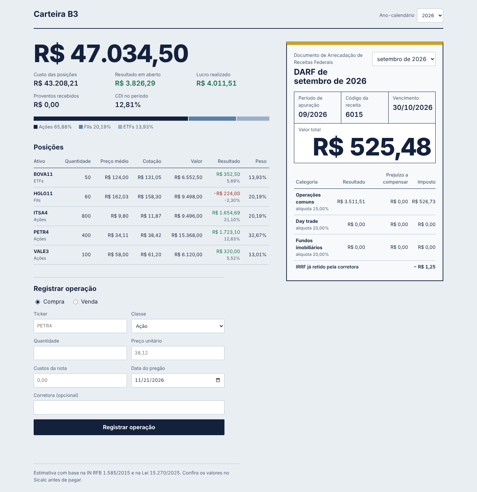
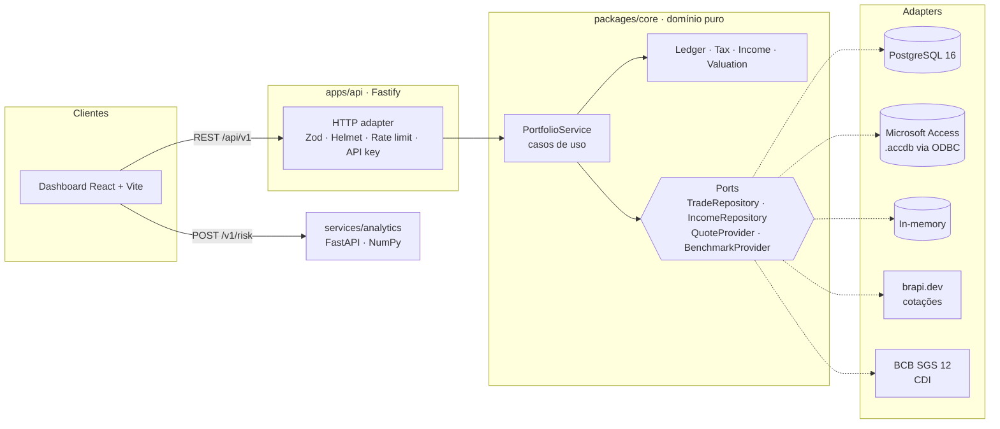

<div align="center">

# b3-portfolio-tracker

**Carteira de investimentos da B3 com preço médio, proventos e apuração mensal do Imposto de Renda, gerando o DARF pronto para pagar.**

[](https://github.com/lucassantana2301-bot/b3-investe-/actions/workflows/ci.yml)
[](https://github.com/lucassantana2301-bot/b3-investe-/releases)




</div>

## O problema

Quem investe na B3 precisa, todo mês, calcular o preço médio de cada ativo, separar day trade de swing trade, verificar a isenção de R$ 20 mil, compensar prejuízos por categoria, descontar o IRRF retido pela corretora e emitir o DARF até o último dia útil do mês seguinte. Errar qualquer passo gera multa e juros na malha fina.

Este projeto automatiza essa apuração com regras de negócio testadas e mostra o resultado como a própria guia de recolhimento.

## Funcionalidades

- **Preço médio ponderado** com custos da nota (corretagem, emolumentos, liquidação), em aritmética decimal exata (`decimal.js`, sem `float`).
- **Day trade x swing trade** separados automaticamente por ativo e pregão, conforme a IN RFB 1.585/2015.
- **Apuração mensal de IR** por categoria (operações comuns, day trade, FII), com:
  - isenção de R$ 20 mil/mês **só para ações** (ETF, BDR e FII não têm);
  - compensação de prejuízo acumulado, inclusive de anos anteriores;
  - desconto do IRRF "dedo-duro" (0,005% e 1%), com dispensa abaixo de R$ 1,00;
  - DARF abaixo de R$ 10,00 acumulado para o mês seguinte;
  - vencimento calculado (último dia útil do mês seguinte) e código de receita 6015.
- **Proventos**: dividendos, JCP (15% retido na fonte) e rendimentos de FII, já com a **retenção de 10% da Lei 15.270/2025** sobre dividendos acima de R$ 50 mil/mês da mesma empresa.
- **Cotações em tempo real** via [brapi.dev](https://brapi.dev) e **benchmark CDI** pela série 12 do SGS do Banco Central, com cache e degradação graciosa (o painel funciona mesmo com a API externa fora).
- **Métricas de risco** em Python: volatilidade anualizada, Sharpe, Sortino, max drawdown, beta e VaR histórico 95%.
- **Dois bancos de dados intercambiáveis**: PostgreSQL para deploy e Microsoft Access (ODBC) para uso local no Windows.

## Arquitetura

Arquitetura hexagonal (Ports & Adapters): o domínio não conhece banco, HTTP nem APIs externas. Trocar Postgres por Access é mudar uma variável de ambiente.



### Estrutura do monorepo

```
b3-portfolio-tracker/
├── packages/core/            # Domínio e casos de uso (TypeScript puro, zero I/O)
│   └── src/
│       ├── domain/           # ledger, tax, income, valuation, money, calendar
│       ├── application/      # ports + PortfolioService
│       └── adapters/         # repositórios in-memory
├── apps/api/                 # Fastify: HTTP, Postgres, Access/ODBC, brapi, BCB
├── apps/web/                 # React + Vite: dashboard e registro de operações
├── services/analytics/       # Python/FastAPI: métricas de risco com NumPy
├── db/
│   ├── migrations/postgres/  # SQL versionado, aplicado com advisory lock
│   └── access/schema.sql     # DDL ANSI-92 para o Access
├── scripts/windows/          # PowerShell: cria o .accdb e aplica o schema
└── .github/workflows/ci.yml  # Lint, typecheck, testes, integração com Postgres, Docker
```

### Decisões técnicas

| Decisão | Motivo |
| --- | --- |
| `decimal.js` com arredondamento bancário | `0.1 + 0.2 !== 0.3` em ponto flutuante; base de imposto exige exatidão. |
| Valores monetários trafegam como `string` no JSON | `number` em JS perde precisão acima de 2⁵³ e em frações. |
| `NUMERIC(18,8)` no Postgres e `DECIMAL` no Access | Mesmo motivo, na camada de persistência. |
| `DATE` lido como string no `pg` | O parser padrão cria `Date` local e pode deslocar o dia conforme o fuso do servidor. |
| Classe do ativo informada, não inferida | Final "11" pode ser FII, ETF ou unit (TAEE11 é ação), e a regra tributária muda. |
| Revalidação do histórico a cada escrita | Uma venda retroativa ou a exclusão de uma compra pode deixar posição negativa. |
| Providers externos com timeout, cache e falha isolada | Cotação indisponível não derruba o painel nem a apuração. |
| API key obrigatória em produção | Dados financeiros pessoais; a config recusa subir sem chave de 32+ caracteres. |

## Como rodar

### Com Docker (Postgres)

```bash
cp .env.example .env
# edite POSTGRES_PASSWORD e gere a API_KEY: openssl rand -hex 32
docker compose up --build
```

Dashboard em http://localhost:8080 e analytics em http://localhost:8000/docs.

### Desenvolvimento local

```bash
npm install
npm run build -w @b3pt/core
DB_DRIVER=memory npm run dev:api   # API em http://localhost:3333
npm run dev:web                    # Dashboard em http://localhost:5173
```

### Com Microsoft Access (Windows)

1. Instale o [Microsoft Access Database Engine 2016 Redistributable](https://www.microsoft.com/download/details.aspx?id=54920) com a **mesma arquitetura do Node.js** (normalmente x64).
2. Crie o banco e aplique o schema:
   ```powershell
   .\scripts\windows\setup-access.ps1 -DatabasePath C:\dados\portfolio.accdb
   ```
3. Instale o driver ODBC para Node e configure a API:
   ```powershell
   npm install odbc -w @b3pt/api
   $env:DB_DRIVER = "access"
   $env:ACCESS_CONNECTION_STRING = "Driver={Microsoft Access Driver (*.mdb, *.accdb)};Dbq=C:\dados\portfolio.accdb;"
   npm run dev:api
   ```

O adapter trata as particularidades do Access: datas `DATETIME` normalizadas para `YYYY-MM-DD`, `DECIMAL` com vírgula conforme a localidade do driver, identificadores entre colchetes (`[type]` é palavra reservada) e upsert manual, já que o Jet/ACE não tem `ON CONFLICT`.

## API

Todas as rotas ficam sob `/api/v1` e exigem `Authorization: Bearer <API_KEY>` quando a chave está configurada.

| Método | Rota | Descrição |
| --- | --- | --- |
| `GET` | `/portfolio` | Posições, valor de mercado, resultado, alocação e CDI do período |
| `GET` | `/trades` | Lista operações |
| `POST` | `/trades` | Registra compra ou venda |
| `DELETE` | `/trades/:id` | Remove operação (bloqueia se invalidar o histórico) |
| `GET` | `/tax?year=2026` | Apuração mensal e DARF |
| `GET` | `/incomes` | Lista proventos |
| `POST` | `/incomes` | Registra dividendo, JCP ou rendimento de FII |
| `GET` | `/incomes/summary?year=2026` | Proventos por mês com retenção na fonte |
| `GET` | `/health/live` · `/health/ready` | Liveness e readiness (checa o banco) |

```bash
curl -X POST localhost:3333/api/v1/trades \
  -H 'content-type: application/json' \
  -d '{"ticker":"PETR4","assetClass":"STOCK","side":"BUY","quantity":100,"unitPrice":"38.12","fees":"4.90","tradeDate":"2026-03-02"}'
```

Erros seguem um formato único: `400` para payload inválido (Zod), `422` para regra de negócio, `409` para conflito com o histórico (venda a descoberto) e `500` sem detalhes internos, só com o `requestId` para rastrear no log.

## Testes

```bash
npm test                     # domínio, HTTP, providers e adapter Access (Vitest)
TEST_DATABASE_URL=postgres://... npm run test:integration   # Postgres real
cd services/analytics && pytest   # métricas de risco
```

Os cenários tributários são testados com valores calculados à mão: isenção de R$ 20 mil, compensação de prejuízo entre meses e entre anos, FII sem misturar com day trade, ETF sem isenção, DARF acumulado abaixo de R$ 10 e crédito de IRRF.

## Stack

**TypeScript** · **Node.js 22** · **Fastify 5** · **Zod** · **decimal.js** · **PostgreSQL 16** · **Microsoft Access (ODBC/ACE)** · **React 18** · **Vite** · **Python 3.13** · **FastAPI** · **NumPy** · **Vitest** · **pytest** · **Ruff** · **ESLint** · **Docker Compose** · **Nginx** · **GitHub Actions** · **PowerShell**

## Limitações conhecidas

- Mercado à vista apenas: opções, termo, futuros e aluguel de ações ficam fora.
- Eventos corporativos (desdobramento, grupamento, bonificação, subscrição) ainda precisam ser lançados como operações manuais.
- O vencimento do DARF considera fins de semana, mas não feriados nacionais.
- O cálculo é uma estimativa: confira no [Sicalc da Receita Federal](https://sicalc.receita.economia.gov.br/) antes de pagar.

## Roadmap

- [ ] Importação de notas de corretagem (PDF SINACOR) e do extrato da Área do Investidor da B3
- [ ] Eventos corporativos com ajuste automático de preço médio
- [ ] Rentabilidade por TWR (time-weighted return) e comparação com IBOV
- [ ] Geração do relatório anual para a declaração (bens e direitos, isentos, renda variável)

## Contribuindo

Veja o [guia de contribuição](CONTRIBUTING.md), o [CHANGELOG](CHANGELOG.md) e a [política de segurança](SECURITY.md). Os itens do roadmap estão abertos como [issues](../../issues).

## Licença

MIT © Lucas Santana Santos
